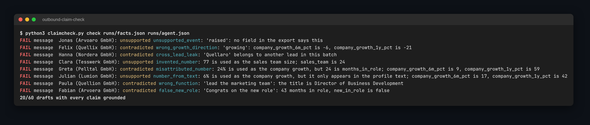

# Outbound claim check

An outbound agent can pass a number check and still write something false. It can write "Congrats on the new role" to someone 43 months in, "With Kranwerk growing fast" when headcount fell 6%, or "Your 21-person SDR team" when 21 is the growth rate and the team is 7. Every number in those drafts is in the lead's data, so a check that asks "does this number appear somewhere?" lets them through.

`claimcheck.py` checks whether each claim in a draft is true of this lead. It reads the same `runs/facts.json` and `runs/agent.json` as [outbound-agent-scorecard](https://github.com/evaboot-labs/outbound-agent-scorecard), so it runs after `scorecard.py` with no changes to either. Nothing is sent.

## Run it

```bash
python3 claimcheck.py check runs/facts.json runs/agent.json
```

```text
FAIL message  Greta (Pelltal GmbH): contradicted misattributed_number: 24% is used as the company growth, but 24 is months_in_role; company_growth_6m_pct is 9, company_growth_1y_pct is 59
FAIL message  Fabian (Arvoera GmbH): contradicted false_new_role: 'Congrats on the new role': 43 months in role, new_in_role is false
FAIL message  Felix (Quellix GmbH): contradicted wrong_growth_direction: 'growing': company_growth_6m_pct is -6, company_growth_1y_pct is -21
FAIL subject  Tobias (Quellaro GmbH): contradicted cross_lead_leak: 'Tesswerk' belongs to another lead in this batch
```

It needs Python 3.9+ and no packages, and it makes no network calls. Add `--strict` to exit 1 on any failed claim, so an agent run can stop before a person reads a bad draft.



## What it checks

| Claim in the draft | Grounded when |
|---|---|
| A number | it matches the field the sentence uses it as: a `%` against growth, "months" against months in role, "SDRs" against the sales team, "people" against employees. A number from the profile text only counts as a quote, not as a figure. |
| New in the role | `new_in_role` is true |
| Growing, scaling, expanding | a growth field is above zero. "Help you grow pipeline" is the offer, not a claim, and is skipped. |
| Funding, hiring, a launch, a post | the words appear in the lead's own headline, summary or company description. The export has no field for them. |
| Their function ("your marketing team") | the title or headline names that function |
| Another lead's first name or company | never: in a batch run, that is context from the previous lead |

Each failure is labelled **contradicted** (the data says otherwise) or **unsupported** (the data does not say it).

## How well it works

`traps/` holds 60 synthetic leads in the `scorecard.py facts` format, with one draft each. 20 drafts are correct. 40 carry one seeded error, five of each kind in the table below. `make_traps.py` builds them from a fixed seed; the people and companies are invented.

```bash
python3 claimcheck.py eval traps
```

| Seeded error | Drafts | number check (scorecard.py) | claimcheck rules |
|---|---|---|---|
| cross lead leak | 5 | 0/5 | 5/5 |
| false new role | 5 | 0/5 | 5/5 |
| invented number | 5 | 5/5 | 5/5 |
| misattributed number | 5 | 0/5 | 5/5 |
| number from text | 5 | 0/5 | 5/5 |
| unsupported event | 5 | 0/5 | 5/5 |
| wrong function | 5 | 0/5 | 5/5 |
| wrong growth direction | 5 | 0/5 | 5/5 |
| **all seeded errors** | 40 | **5/40** | **40/40** |
| clean drafts flagged (false alarms) | 20 | 0/20 | 0/20 |

The number check column is `numbers_ok` from `scorecard.py`, copied unchanged. It catches invented numbers, which is the job it was written for. Every trap draft also passes the scorecard's message rules (45 to 55 words, subject under 60 characters, greets by first name, no template phrase, no link), so the other 35 errors would reach a person looking ready to send.

**Read 40/40 with care.** I wrote the rules and the traps together, so 40/40 shows that each rule does what it says, not that the rules generalise. Real drafts will word things in ways these regexes miss. The judge in the next section is there to catch those, and the first item under Next measures both on real drafts.

## Second opinion from Claude

```bash
python3 claimcheck.py judge runs/facts.json runs/agent.json > runs/judge.json
python3 claimcheck.py eval traps --judge runs/judge-traps.json
```

`judge` sends each draft and the lead's fields to Claude, but never the lead's email address or LinkedIn ID. Claude lists every claim and labels it supported, contradicted or unsupported, with the fields it rests on. `eval --judge` scores the judge next to the rules on the same drafts and reports Cohen's kappa, which measures how often the two agree beyond chance. The drafts where they disagree are the ones to read by hand. The judge needs `ANTHROPIC_API_KEY` in `.env`, and `CLAUDE_MODEL` overrides the model. It is unit-tested with a stubbed reply; I have not yet run it against the API on the traps.

## CI

`.github/workflows/eval.yml` runs the tests, checks `traps/` matches `make_traps.py`, and fails the build if the rules catch fewer than 90% of seeded errors or raise any false alarm on a clean draft.

## Next

1. **Label 50 real drafts.** Run the agent from outbound-agent-scorecard on a real export, mark each claim by hand as supported, contradicted or unsupported, and add the set beside `traps/`. Then report how many errors the rules and the judge catch on it, and how many false alarms they raise. Those results, not 40/40, show whether the rules work.
2. **Langfuse.** Log each run as a Langfuse experiment, with one score per check, so a prompt or model change shows up as a drop in a chart and not in a customer's inbox.
3. **Gate the send.** In the SDR agent, a draft with a contradicted claim goes back to the agent with the FAIL line; an unsupported one goes to a person.

---

Built by David Asmah as a companion to [evaboot-labs/outbound-agent-scorecard](https://github.com/evaboot-labs/outbound-agent-scorecard) · [MIT license](LICENSE)
